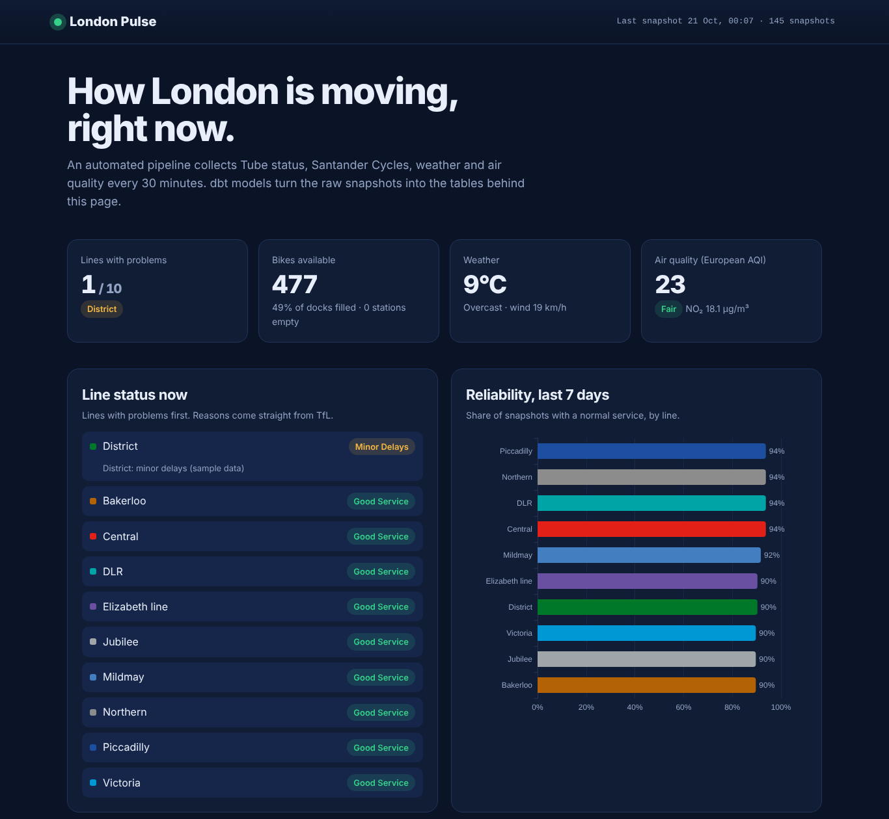
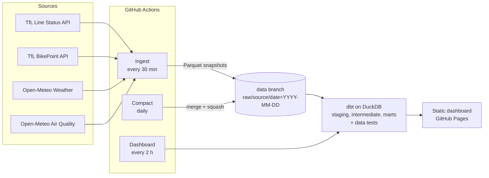

# London Pulse

[](https://github.com/EgeErenler/london-pulse/actions/workflows/ci.yml)
[](https://github.com/EgeErenler/london-pulse/actions/workflows/ingest.yml)
[](https://github.com/EgeErenler/london-pulse/actions/workflows/dashboard.yml)

An automated data pipeline that takes London's pulse every 30 minutes: Tube and rail status,
Santander Cycles availability, weather and air quality. Raw snapshots are stored as Parquet,
modelled with dbt on DuckDB, tested, and published as a live dashboard.

**Live dashboard: [egeerenler.com/london-pulse](https://egeerenler.com/london-pulse/)**



## What it answers

- Which lines are disrupted right now, and why?
- How reliable was each line over the last week?
- At what time of day do disruptions cluster?
- Does rain change how many Santander Cycles are in use?
- Which docking stations are empty or full at this moment?

## Architecture



## Data model

| Layer | Model | Grain |
|---|---|---|
| Staging | `stg_tfl__line_status` | one status per line per snapshot |
| Staging | `stg_tfl__bikepoints` | one docking station per snapshot |
| Staging | `stg_open_meteo__weather`, `stg_open_meteo__air_quality` | one reading per snapshot |
| Intermediate | `int_line_status__per_snapshot` | one row per line per snapshot, most serious status kept |
| Mart | `dim_lines` | one row per line |
| Mart | `fct_line_status_daily` | line and day: share of time with good service |
| Mart | `fct_disruptions_by_hour` | line and hour of day: share of time disrupted |
| Mart | `fct_bike_network_snapshots` | whole bike network per snapshot |
| Mart | `fct_station_latest` | latest reading per station |
| Mart | `mart_city_pulse_hourly` | transport, bikes, weather and air per hour |

Every model is covered by dbt tests (uniqueness, not null, accepted values, relationships and
custom range checks).

## Tech stack

Python 3.11+ · requests · pandas · PyArrow · DuckDB · dbt · pytest · Ruff · GitHub Actions ·
GitHub Pages · ECharts · Leaflet

## Run it locally

No API keys are needed. The `demo` target uses synthetic data, so it works offline.

```bash
git clone https://github.com/EgeErenler/london-pulse.git
cd london-pulse
python -m venv .venv && source .venv/bin/activate
make install
make demo          # sample data -> dbt build -> site/index.html
```

To collect real data instead of sample data:

```bash
LP_DATA_DIR=data london-pulse ingest
make models dashboard
```

## Project structure

```
src/london_pulse/      Python package: API clients, storage, CLI, dashboard builder
  sources/             one module per data source, each with a pure parse() function
dbt/                   dbt project: staging, intermediate and mart models, tests, macros
tests/                 pytest suite with real-shaped API fixtures
.github/workflows/     CI, ingest, compaction and dashboard pipelines
docs/decisions.md      why things are built this way, with trade-offs
```

## Design decisions

The short version: snapshots on a schedule, Parquet on a separate branch, dbt for modelling,
tests at both the code and the data level, and a static dashboard that cannot go down.
The reasoning and trade-offs are in [docs/decisions.md](docs/decisions.md).

## Data sources and licences

- Powered by TfL Open Data. Contains OS data © Crown copyright and database rights.
- Weather and air quality data by [Open-Meteo.com](https://open-meteo.com/), licensed under CC BY 4.0.
- Map tiles © OpenStreetMap contributors © CARTO.

## Author

**Ege Erenler**, software engineer and data scientist in London.
[egeerenler.com](https://egeerenler.com) · [LinkedIn](https://www.linkedin.com/in/ege-erenler)

Released under the MIT licence.
